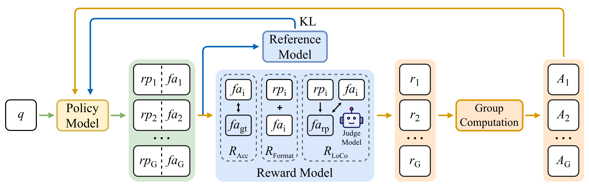
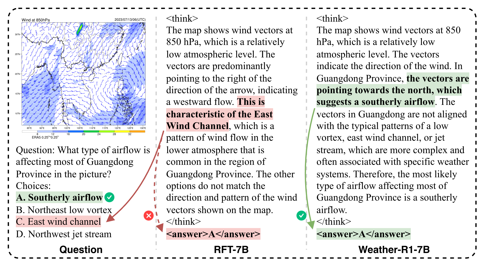
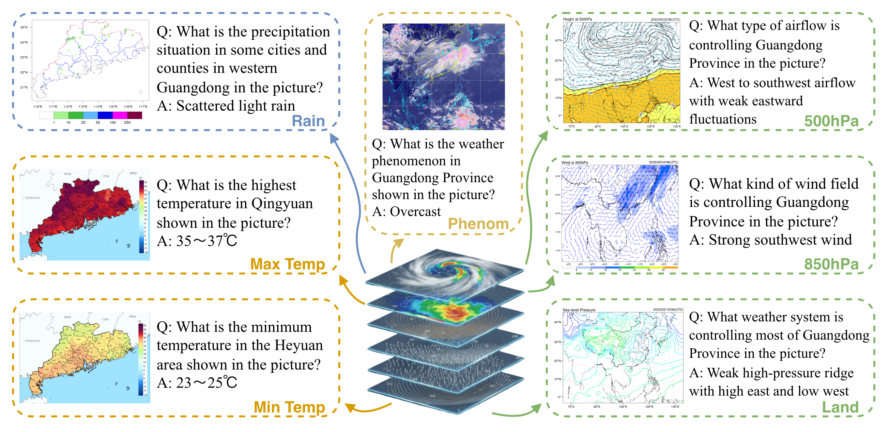

<h1 align="center">
Weather-R1: Logically Consistent Reinforcement Fine-Tuning for Multimodal Reasoning in Meteorology
</h1>

<div align="center">
<p><em>
一个在气象领域具备逻辑忠实性的推理型多模态大模型。
</em></p>
<a href="https://arxiv.org/abs/2601.14044"></a>
<a href="https://huggingface.co/Marco711/Weather-R1"></a>
<a href="https://huggingface.co/datasets/Marco711/WeatherQA"></a>
<p>
<a href="mailto:wuky28@mail2.sysu.edu.cn">伍开钰</a>, <a href="mailto:hanpch@gd121.cn">韩浦城</a>, <a href="mailto:zhlchris@126.com">张华龙</a>, <a href="mailto:wunaigeng@hotmail.com">吴乃庚</a>, <a href="mailto:kezewang@gmail.com">王可泽</a>
</p>
<p>
[ <a href="README.md">English</a> | 中文 ]
</p>
</div>

# 目录

- [引言](#introduction)
- [亮点](#highlights)
- [项目结构](#folder-structure)
- [环境配置](#setup)
- [训练](#training)
- [评测](#evaluation)
- [致谢](#acknowledgements)
- [引用](#citation)

<a id="introduction"></a>
# 🌤️ 引言

视觉语言模型（VLM）的推理能力不断提升，但在气象领域仍受到领域差距与推理忠实性缺口的限制。主流的强化微调（RFT）易出现推理过程与最终答案矛盾的 Self-Contradictory Reasoning（Self-Contra），在高风险场景难以接受。

为应对上述挑战，我们构建了覆盖 4 大主题、7 种成像模态任务的多模态选择题基准 WeatherQA，共 15,400 条样本。我们提出逻辑一致强化微调（Logically Consistent Reinforcement Fine-Tuning，LoCo-RFT），通过引入逻辑一致性奖励抑制 Self-Contra。基于该范式和 WeatherQA，我们训练了 Weather-R1，据我们所知，它是首个在气象领域具备逻辑忠实性的推理型 VLM。Weather-R1（7B）在 WeatherQA 上达到 52.9% 准确率，比基线 Qwen2.5-VL-7B 提升 9.8 个百分点；其表现优于 SFT 与 RFT 基线，超过原始 Qwen2.5-VL-32B，并在域外的 ScienceQA 上提升 4.98 个百分点。

<a id="highlights"></a>
# ✨ 亮点

- LoCo-RFT 在 RFT 中加入逻辑一致性奖励，约束推理过程与最终答案一致，抑制 Self-Contra 现象。

<div align="center">
  
  <p><em>LoCo-RFT（逻辑一致强化微调）范式。</em></p>
</div>

- Weather-R1 是首个面向气象的逻辑一致推理 VLM，利用 LoCo-RFT 训练以提供忠实的多模态推理。

<div align="center">
  
  <p><em>回复对比示例。</em></p>
</div>

- WeatherQA 是面向气象的多模态选择题基准，含 15,400 条样本，覆盖 4 大主题和 7 种成像模态，为专业推理与评测提供高质量监督。

<div align="center">
  
  <p><em>WeatherQA 数据示例。</em></p>
</div>

- Weather-R1（7B）在 WeatherQA 上取得 52.9% 准确率，比 Qwen2.5-VL-7B 提升 9.8 个百分点；优于 SFT 与 RFT 基线，超过 Qwen2.5-VL-32B，并在域外 ScienceQA 上提升 4.98 个百分点。

<a id="folder-structure"></a>
# 🗂️ 项目结构

```file tree
Weather-R1
├── README.md
├── data/                     # 数据集放置目录
│   ├── WeatherQA/            # 训练/验证/测试划分及图像
│   └── ScienceQA-Weather-R1/ # 域外 ScienceQA 评测集及图像
├── easyr1/                   # EasyR1 子模块
├── models/                   # 下载的模型与检查点
├── requirements/             # 环境锁定文件（参考用）
├── results/                  # 训练/评测输出
├── scripts/                  # 环境、训练与评测入口脚本
└── src/                      # 训练/评测源码
    ├── eval/                 # 指标、答案生成、Self-Contra 统计
    ├── models/               # 模型封装（Qwen、LLaVA、API）
    ├── utils/                # 提示词、路径与工具
    └── weather_r1/           # 核心 LoCo-RFT 代码，含配置、奖励与格式模板
```

<a id="setup"></a>
# 🛠️ 环境配置

## vLLM（评测模型）环境

- 参考官方安装指南：https://docs.vllm.ai/en/v0.10.1.1/getting_started/installation/gpu.html
- 导出的 `pip` 与 `conda` 环境文件位于 [`requirements/vllm-pip-requirements.txt`](requirements/vllm-pip-requirements.txt) 与 [`requirements/vllm-conda-list.txt`](requirements/vllm-conda-list.txt)，可用于核对依赖。

```bash
conda create -n vllm-weather-r1 python=3.12
conda activate vllm-weather-r1
pip install vllm==0.10.1.1 --extra-index-url https://download.pytorch.org/whl/cu128
```

## EasyR1（LoCo-RFT 训练）环境

- 对齐官方 EasyR1 v0.3.1 环境，安装步骤见 [EasyR1 README](easyr1/README.md)。
- 导出的 `pip` 与 `conda` 环境文件位于 [`requirements/easyr1-pip-requirements.txt`](requirements/easyr1-pip-requirements.txt) 与 [`requirements/easyr1-conda-list.txt`](requirements/easyr1-conda-list.txt)，可用于核对依赖。
- 基于 [EasyR1 v0.3.1 Dockerfile](easyr1/Dockerfile)，我们提供了一键安装脚本 [`scripts/easyr1_install.sh`](scripts/easyr1_install.sh)。

```bash
conda create -n easyr1-weather-r1 python=3.12
conda activate easyr1-weather-r1
cd easyr1
bash ../scripts/easyr1_install.sh
```

## 数据与模型准备

- 数据
  - WeatherQA：从 https://huggingface.co/datasets/Marco711/WeatherQA 下载，置于 `data/WeatherQA`。
  - ScienceQA-Weather-R1：从 https://huggingface.co/datasets/Marco711/ScienceQA-Weather-R1 下载，置于 `data/ScienceQA-Weather-R1`。
- 模型
  - 训练模型：从 https://huggingface.co/Qwen/Qwen2.5-VL-7B-Instruct 下载 `Qwen2.5-VL-7B-Instruct`，置于 `models/Qwen/Qwen2.5-VL-7B-Instruct`。
  - 评测模型：从 https://huggingface.co/openai/gpt-oss-20b 下载 `openai/gpt-oss-20b`，置于 `models/openai/gpt-oss-20b`。
- 评测前请在 [`src/utils/model_path.json`](src/utils/model_path.json) 中填写本地路径或 Hugging Face 模型名。

<a id="training"></a>
# 🚀 训练

1. 启动评测模型（仅此步骤使用 vLLM 环境）：
    ```bash
    conda activate vllm-weather-r1
    bash scripts/start_vllm_judge_model.sh
    ```
2. 编辑训练脚本 [`scripts/qwen2_5_vl_7b_weather_r1_locorft_bf16.sh`](scripts/qwen2_5_vl_7b_weather_r1_locorft_bf16.sh)，关键参数：
    - `EXPERIMENT_NAME`：实验名称与输出目录
    - `TRAIN_FILE`：训练集路径
    - `REWARD_WEIGHTS`：LoCo-RFT 奖励权重
    - `CLIENT_MODEL`：评测模型类型
    - 其他参数按需调整
3. 使用 LoCo-RFT 训练 Weather-R1（此步及之后使用 EasyR1 环境）：
    ```bash
    conda activate easyr1-weather-r1
    bash scripts/qwen2_5_vl_7b_weather_r1_locorft_bf16.sh
    ```
4. 训练结束后合并检查点（调整 `local_dir` 为你的运行目录）：
    ```bash
    python easyr1/scripts/model_merger.py --local_dir checkpoints/easy_r1/exp_name/global_step_1/actor
    ```

## 基线训练

- RFT：沿用 LoCo-RFT 流程，在 [`scripts/qwen2_5_vl_7b_weather_r1_locorft_bf16.sh`](scripts/qwen2_5_vl_7b_weather_r1_locorft_bf16.sh) 中取消第 21 行的注释以关闭逻辑奖励：`REWARD_WEIGHTS ('{"format":0.1,"logic":0.0,"accuracy":0.9}')`。
- SFT：参考 [LlamaFactory](https://github.com/hiyouga/LlamaFactory.git) 进行 SFT 训练。

<a id="evaluation"></a>
# 📊 评测

## Qwen-2.5-VL 系列

1. 设置模型路径：在 [`src/utils/model_path.json`](src/utils/model_path.json) 中填写待测模型名称与路径。
2. 配置评测模型与数据集：在 [`scripts/eval_scienceqa_weatherqa_multi_gpu.sh`](scripts/eval_scienceqa_weatherqa_multi_gpu.sh) 中设置 `model_name` 与 `data_type`（`SQA_qcm_a` / `WCQ_en`），并选择对应的 `prompt_type`（如 `weather-r1`）。
3. 运行评测脚本：
    ```bash
    bash scripts/eval_scienceqa_weatherqa_multi_gpu.sh
    ```

## LLaVA-v1.6 系列

- 环境配置参考 [LLaVA](https://github.com/haotian-liu/LLaVA) 仓库。
- 其余步骤与 Qwen-2.5-VL 系列类似。

## 统计分析

### 主实验指标

1. 在 [`src/eval/get_metric.py`](src/eval/get_metric.py) 中将 `folder` 路径改为待汇总目录。
2. 运行指标汇总脚本：
    ```bash
    python -m src.eval.get_metric
    ```

### Self-Contra 统计

1. 使用评测模型获取推理过程最终答案（$fa_{rp}$）：
    ```bash
    python -m src.eval.get_final_answer_of_reasoning_process
    ```
2. 统计 Self-Contra 现象：
    ```bash
    python -m src.eval.self_contra_count -i <folder_of_fa_rp_jsonl> -o <output_csv_path>
    ```

<a id="acknowledgements"></a>
# 🙏 致谢

训练代码基于 [EasyR1](https://github.com/hiyouga/EasyR1)。

<a id="citation"></a>
# 📝 引用

如果你使用了 Weather-R1 的资源，请引用以下论文：

```bibtex
@misc{wu2026weatherr1logicallyconsistentreinforcement,
      title={Weather-R1: Logically Consistent Reinforcement Fine-Tuning for Multimodal Reasoning in Meteorology}, 
      author={Kaiyu Wu and Pucheng Han and Hualong Zhang and Naigeng Wu and Keze Wang},
      year={2026},
      eprint={2601.14044},
      archivePrefix={arXiv},
      primaryClass={cs.CV},
      url={https://arxiv.org/abs/2601.14044}, 
}
```
